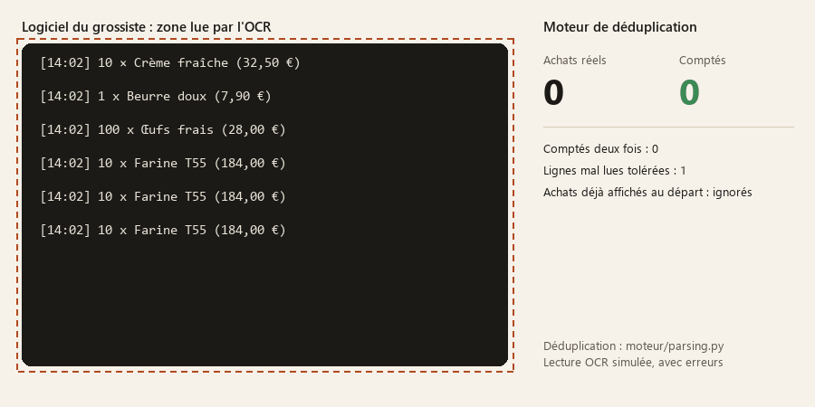

# OCR en temps réel : extraire des données fiables d'un flux affiché à l'écran

Python · Tesseract · rapidfuzz · WebSocket · Windows



*Animation générée par [`docs/animation/generer.py`](docs/animation/generer.py) : un fil de commandes fictif défile, la lecture OCR est simulée avec des erreurs, et la déduplication est celle du moteur (`DedupeurDeFlux`). Le script échoue si le compte diffère du nombre réel d'achats.*

Un moteur qui **lit une zone de l'écran en continu**, en extrait des événements
structurés et les compte **une fois et une seule**, même quand l'affichage défile,
se répète ou est mal lu.

L'exemple de ce dépôt : un restaurant veut connaître **le coût réel de chaque plat**.
Ses achats passent par le logiciel de commande de son grossiste, qui affiche chaque
achat dans un fil de messages (le « chat » dans le code) mais n'offre ni API ni
export. Le moteur lit ce fil à l'écran pendant les commandes, reconnaît les
ingrédients des recettes suivies et calcule le prix moyen payé, puis le coût et la
marge de chaque plat, sans aucune saisie. Le même problème se pose partout où une
application n'a pas d'API : logiciels métier anciens, terminaux, tableaux de bord
qu'on ne peut que regarder.

## Le problème

- Un OCR se trompe : caractères mal lus, accents perdus, lignes coupées en deux.
- Le fil défile. Deux captures successives se recouvrent en partie, et il faut
  savoir exactement où reprendre.
- Quarante achats identiques au même prix donnent quarante lignes identiques au
  pixel près : on ne peut pas dédupliquer par le contenu.
- Il faut suivre le rythme (3 à 8 achats par seconde) avec un OCR qui prend environ
  300 ms par image.

## Les solutions

- **Déduplication par position, jamais par contenu.** Le moteur cherche le plus long
  recouvrement entre la fin du flux déjà accepté et le début de la nouvelle capture,
  en tolérant des écarts d'OCR. Trois achats identiques d'affilée comptent pour trois
  ([`parsing.py`](moteur/parsing.py), `DedupeurDeFlux`).
- **Resynchronisation prudente.** Si l'alignement échoue, le moteur se recale sans
  recompter. Ce qui est ambigu part dans une file « à confirmer » ; rien n'est jamais
  compté d'office.
- **Rapprochement flou.** Les noms lus sont comparés aux ingrédients attendus avec
  rapidfuzz, sans tenir compte des accents : au-dessus de 90 accepté, entre 70 et 90
  à confirmer, en dessous non identifié.
- **Pipeline à deux fils.** Capture (`mss`) → file courte → OCR (`pytesseract`). La
  file jette l'image la plus ancienne quand l'OCR prend du retard, et les images
  identiques sont sautées.
- **Rejeu hors ligne.** Une vraie session peut être enregistrée puis rejouée
  ([`rejouer.py`](moteur/rejouer.py)) sans Tesseract ni logiciel fournisseur : on
  teste une modification du parsing sur des données réelles avant de la livrer.

## Deux bugs réels, et ce qu'ils ont appris

- **Un achat compté 9 fois.** Des fenêtres « toujours au-dessus » posées sur le fil
  affichaient le journal du moteur... qui était relu par l'OCR, recompté, rejournalisé.
  Correctif : toutes les fenêtres de l'outil sont exclues de la capture
  (`SetWindowDisplayAffinity`) et le moteur tourne sans console. Un test le vérifie
  ([`tests/test_exclusion.py`](moteur/tests/test_exclusion.py)).
- **935 resynchronisations en une soirée.** Le fil agrandi affichait 62 messages
  alors que l'historique n'en gardait que 60 : aucun alignement n'était plus
  possible. Correctif : l'historique garde toujours au moins une capture entière.

## Tests

119 tests : parsing, déduplication, rapprochement, pipeline, vrai serveur WebSocket,
zone de capture multi-écrans, exclusion de capture, et un test avec le **vrai**
Tesseract sur une image fabriquée (ignoré s'il est absent, comme le pack de langue
`fra`).

```
cd moteur
pip install -r requirements.txt
python -m pytest
```

## Essayer sans logiciel fournisseur

`python demo_chat.py` ouvre un faux fil de commandes qui débite des messages d'achat
réalistes, avec un bouton « Rafale » et des messages à ignorer. Le détail du
fonctionnement est dans [moteur/README.md](moteur/README.md).

## Contexte

Le moteur est le cœur d'un plugin d'[ExziHub](https://github.com/Exzitech/exzihub-app),
qui fournit l'interface (liste d'achats, fenêtres flottantes au-dessus du logiciel
lu) et le pilote en WebSocket. L'outil ne fait que lire l'écran : il n'automatise
aucune action dans le logiciel qu'il observe.

Licence MIT.
